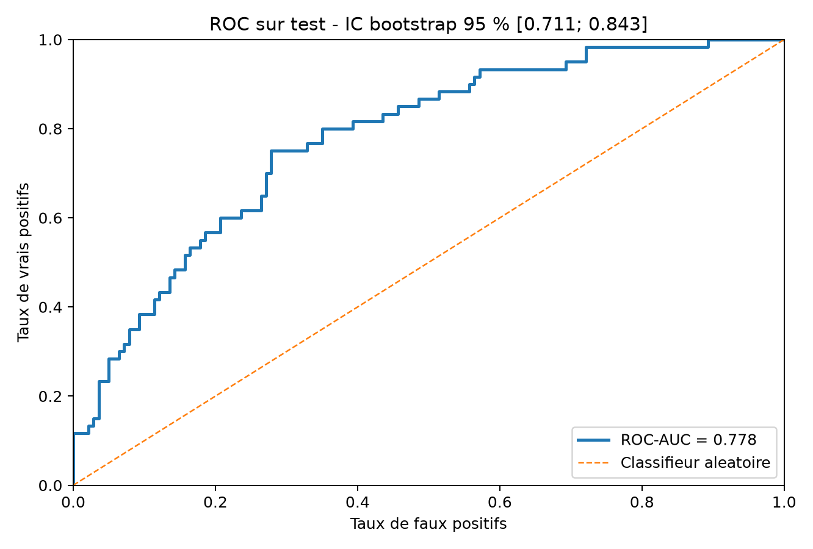
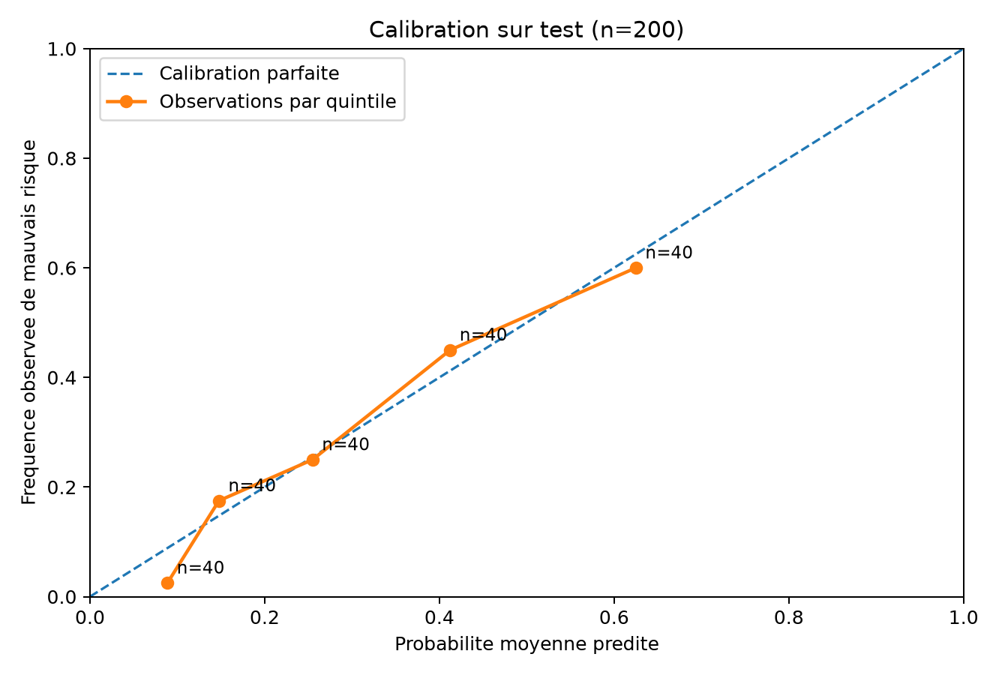
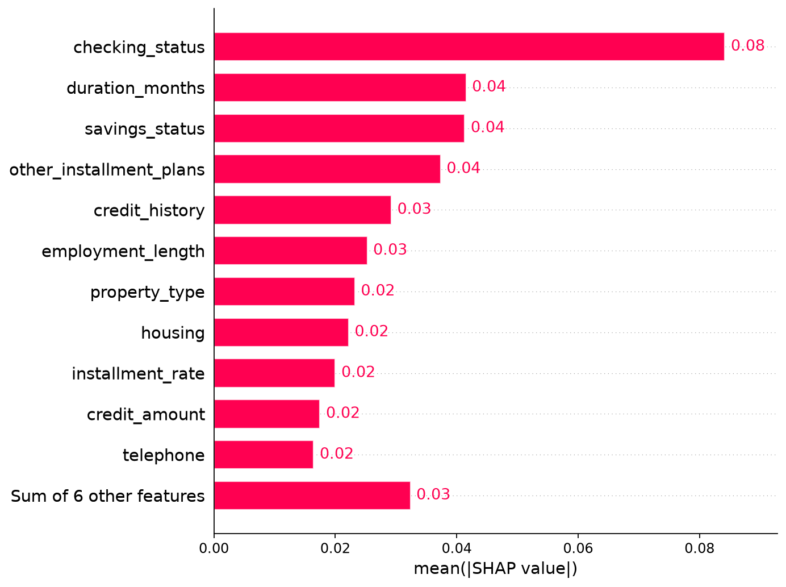

# Credit Risk Lab — Explainable Credit Risk Scoring (Educational Project)

> **Status:** reproducible learning prototype; **not** approved for real lending or credit decisions. Based on historical German Credit data (1994), not a contemporary Moroccan or international banking sample.

## Business question

Can we distinguish historical *bad credit risk* from *good credit risk*, estimate probabilities responsibly, and explain the model's predictions? We compare a statistical baseline (logistic regression) against a Random Forest, each probability-calibrated using training-only cross-validation, then select a model and a decision threshold **using validation data only**.

**Target variable definition:** The original German
Credit dataset labels credit records as good risk (1)
or bad risk (2). For binary classification, these
labels are mapped to 0 (good risk) and 1 (bad risk).
The model estimates the probability of belonging
to the historical bad-credit-risk class, not a
validated probability of default for contemporary
banking populations.


## Verified results from the original run

| Item | Result |
|---|---:|
| Dataset | 1,000 historical records / 20 explanatory variables |
| Split, stratified with `random_state=42` | 600 train / 200 validation / 200 test |
| Selected model (validation cost) | Calibrated Random Forest |
| Selected threshold (validation) | 0.26 |
| Validation ROC-AUC, selected model | 0.8132 |
| Test ROC-AUC | **0.7779** |
| Stratified bootstrap percentile 95% CI (test, 2,000 draws) | **[0.7111, 0.8426]** |
| Test PR-AUC | 0.6091 |
| Test Brier score | 0.1676 |
| Test recall of bad risk | 47/60 = 78.3% |
| Test specificity for good risk | 91/140 = 65.0% |

Illustrative costs: false negative (missed bad risk) = 5 units, false positive = 1 unit. These are **not real monetary losses**. Small validation differences (85 vs 89 cost units) should not be overinterpreted. Scores can vary with the split and sample. Never retune a model based on the final test results.

### ROC Curve — Independent Test Set



### Probability Calibration



### Explainable AI — SHAP Feature Importance



**Interpretation:** Global feature importance is measured
using the mean absolute SHAP value across 30 sampled
validation observations. Larger values indicate a
stronger average contribution to model predictions,
without indicating whether a variable increases or
decreases predicted risk. SHAP explanations describe
model behavior, not causal relationships.

## Install & reproduce (macOS / Linux)

```bash
python3 -m venv .venv
source .venv/bin/activate
python -m pip install -r requirements.txt
python scripts/download_data.py
# If Python reports an SSL certificate issue, download german.data directly from UCI
# using your browser and place it at data/german.data (do NOT disable SSL verification).
python -m pytest -q
python -m src.train
python -m src.validation_avancee
python -m src.explication_shap --n-explain 30
python scripts/eda.py
python scripts/eda_graphique.py
python scripts/analyse_risque.py
python -m streamlit run app.py
```

On Windows PowerShell, activate with `.venv\Scripts\Activate.ps1`. Commands are run from the repository **root**, not inside `src/`.

**Publishing note:** `data/german.data`, the trained `models/*.joblib` and individual `reports/test_predictions.csv` are excluded from the public repository. They are generated locally. Images and aggregate JSON summaries in `reports/` show example outputs from the verified original run; regenerate all outputs on your own computer after obtaining the data. The dashboard requires aggregate metrics **and** local test predictions; it explains how to regenerate them if missing.

## Repo map

| Path | Purpose |
|---|---|
| `src/data.py` | Data schema, label encoding (`1 → 0 good`, `2 → 1 bad`), protected-feature exclusions |
| `src/train.py` | 60/20/20 stratified split, preprocessing, CV calibration, model/threshold selection |
| `src/validation_avancee.py` | Held-out test ROC, bootstrap CI, diagnostic calibration curve |
| `src/explication_shap.py` | Permutation SHAP of the **entire calibrated model**, using train background + validation examples |
| `scripts/eda.py` | Descriptive statistics and quintile summaries |
| `scripts/eda_graphique.py` | Interactive duration and credit-amount visualizations |
| `scripts/analyse_risque.py` | Exploratory credit-amount quintiles and chi-square independence test |
| `app.py` | Streamlit dashboard displaying performance, SHAP, ROC and calibration |
| `tests/` | Automated tests, including metric and data-format checks |
| `docs/AUDIT_METHODOLOGIQUE.md` | Review findings, limitations and publication checklist |

## SHAP and risk interpretation

The explanation code uses **permutation SHAP** on the complete calibrated estimator, rather than TreeExplainer on just one uncalibrated forest. The original global importance image averaged absolute contributions over **five** validation observations; the updated script defaults to **30** and saves its sample size to `reports/shap_metadata.json`. Increase only if computing resources permit. Model contributions describe predictions **not causal mechanisms**. Credit categories such as `A11` are nominal codes, not numeric intensity scales.

## Scientific limitations

1. German Credit 1994 is small and historically/regionally outdated. It is not appropriate for real underwriting.
2. Excluding age, `personal_status_sex`, and `foreign_worker` from features is a precaution, **not proof of fairness**; proxy effects and group performance were not validated.
3. Calibration plots show five bins with approximately 40 cases each; they are descriptive, not definitive evidence of perfect calibration.
4. The original EDA and chi-square analysis used all 1,000 records. **Although model fitting and selection used disjoint train/validation/test splits**, those exploratory examinations were not isolated from test labels. A genuinely prospective evaluation would freeze hypotheses before accessing final-test outcomes and use fresh external data.
5. Threshold 0.26 was selected for toy asymmetric costs on validation and is sensitive to sampling uncertainty. For calibrated probabilities, a theoretical cost-based threshold is `C_FP/(C_FP + C_FN) = 1/6 ≈ 0.167`, under the simple two-error cost assumptions; validating operational costs requires much stronger evidence.
6. Tests check software behavior, not regulatory compliance, robustness on contemporary populations, or that the model is ready for banking.

## Data citation and license

Hofmann, H. (1994), **Statlog (German Credit Data)**, UCI Machine Learning Repository. DOI: https://doi.org/10.24432/C5NC77. Official dataset: https://archive.ics.uci.edu/dataset/144/statlog+german+credit+data. See the official dataset page for the latest applicable license and required attribution. The helper `scripts/download_data.py` points to a GitHub mirror; downloading directly from UCI is preferable whenever possible.

## GitHub portfolio guidelines

- Use a description such as: *Explainable credit risk scoring | Logistic Regression vs Random Forest | Validation-only model selection | SHAP | Streamlit*.
- Showcase `reports/roc_test.png`, `reports/calibration_test.png`, and SHAP figures with captions stating dataset age and sample limitations.
- Include genuine commands/results; do **not** claim production readiness, fairness certification, deployment, or unseen external validation.
- `joblib` files rely on Python pickle semantics: **never load serialized models from untrusted sources**.
- Before a GitHub release, rerun the project and tests locally, ensure `shap_metadata.json` matches plots, and compare the metrics generated with the published summary.

## Further work (not yet implemented)

Uncertainty intervals for subgroup performance; larger SHAP explanation sample; robust cross-seed or external validation; MLflow experiment tracking; production-grade inference API; drift monitoring. These are **future extensions**, not completed features.
 